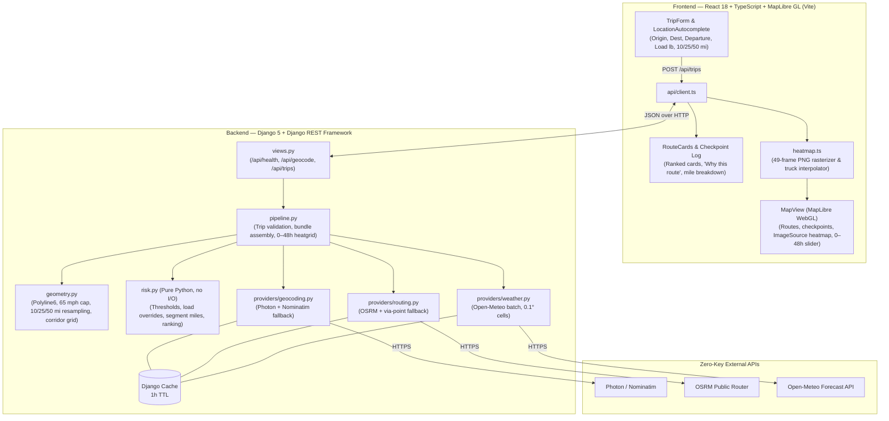

# Spotter — Weather-Aware Truck Routing

A **React (Vite + TypeScript + MapLibre GL) + Django (DRF)** web application that helps a truck driver pick the safest route between an origin and destination based on **arrival-time weather forecasts, load weight rules, and travel time**.

> Dedicated module guides: **[Backend README](backend/README.md)** · **[Frontend README](frontend/README.md)** · 

---

## 1. Technical Architecture



---

## 2. Frontend & Backend Breakdown

### 2.1 Backend (`backend/`)
- **`config/settings.py` & `config/urls.py`**: Django configuration, CORS, WhiteNoise static serving for single-service deployment, and URL routes.
- **`routing_app/views.py`**: DRF API views with structured JSON error handling:
  - `GET /api/health` — liveness check.
  - `GET /api/geocode?q=...` — US/Canada-biased place autocomplete proxy.
  - `POST /api/trips` — validates input (`departure_time`, `load_lb`, origin/destination) and returns the complete trip bundle (`routes`, `intervals["10"|"25"|"50"]`, `heat_grid`, `notices`).
- **`routing_app/providers/`**: Swappable, mockable HTTP adapters with timeouts, retries, and 1-hour caching:
  - `geocoding.py`: Photon (Komoot) with automatic Nominatim fallback.
  - `routing.py`: OSRM (`alternatives=3`, `geometries=polyline6`, `annotations=distance,duration`). If fewer than 3 distinct routes (`< 70%` interior overlap) return, queries perpendicular via-waypoints from the corridor midpoint (`0.0`, `±14%`, `±25%` of route length, with duration fallback up to `1.95x`) to guarantee 3 distinct drivable corridors.
  - `weather.py`: Open-Meteo batch queries (`75` cells/request, parallel batches, `wind_speed_unit=mph`, `precipitation_unit=inch`) using `rain + showers` and `snowfall`, plus linear temporal interpolation at each checkpoint's exact truck ETA.
- **`routing_app/geometry.py`**: Haversine distance, `polyline6` codec, configurable `65 mph` truck speed cap (`min(osrm_segment_speed, 65 mph)`), checkpoint resampling (`10 / 25 / 50 mi`), overlap detection, `0.1°` cell snapping, and adaptive corridor heatmap grid builder (`<= 200` active cells).
- **`routing_app/risk.py`**: Pure-Python risk classification, strict load-weight overrides, Voronoi midpoint segment miles, and deterministic route ranking.

### 2.2 Frontend (`frontend/src/`)
- **`hooks/useTripPlanner.ts`**: Custom hook managing trip state, interval/route selection, and API errors.
- **`api/client.ts`**: Typed fetch client (`searchGeocode`, `planTrip`) with structured `ApiRequestError` handling.
- **`components/Header.tsx`, `StatusBanners.tsx`, `RulesModal.tsx`**: Thin shell components for top bar, error/No-Travel alerts, and risk-rule reference modal.
- **`components/TripForm.tsx` & `LocationAutocomplete.tsx`**: Debounced place search, freight presets, client validation, and instant `10 / 25 / 50 mi` toggle (zero network calls).
- **`components/RouteCards.tsx` & `CheckpointLogTable.tsx`**: Ranked route cards, **"Why this route"** comparisons, and clickable checkpoint weather log.
- **`utils/heatmap.ts` & `utils/mapLayers.ts`**: 49-frame PNG canvas rasterizer, truck position interpolator, and GeoJSON builders.
- **`components/MapView.tsx`, `HeatmapControls.tsx`, `CheckpointModal.tsx`, `ForecastSlider.tsx`**: MapLibre GL WebGL map, metric tabs, checkpoint popup, and 60 FPS `0–48h` slider using `requestAnimationFrame` + refs (zero React re-renders).

---

## 3. Key Domain Decisions

### 3.1 Weather Fields & Truck Speed Cap
- **Wind**: Classified on steady `wind_speed_10m` (`mph`), while `wind_gusts_10m` is shown in checkpoint details.
- **Rain vs. Snow**: Uses `rain + showers` (`in/hr`) for rain and `snowfall` (`in/hr`) for snow. Open-Meteo's `precipitation` field is intentionally avoided because it includes melted snow, which would double-count snow events.
- **Truck Speed Cap**: Every OSRM road segment is capped at `min(osrm_segment_speed, 65 mph)` (`TRUCK_MAX_SPEED_MPH`) so checkpoint ETAs reflect realistic truck speeds rather than passenger car speeds.

### 3.2 Risk Thresholds (Conservative Edge Convention)
| Condition | Low (1) | Moderate (2) | High (3) | Severe (4) | No Travel (5) |
|---|---|---|---|---|---|
| **Wind (mph)** | `[0, 25)` | `[25, 35)` | `[35, 45)` | `[45, 55)` | `≥ 55` |
| **Rain (in/hr)** | `[0, 0.10)` | `[0.10, 0.25)` | `[0.25, 0.50)` | `[0.50, 1.00]` | `> 1.00` |
| **Snow (in/hr)** | `[0, 0.5)` | `[0.5, 1.0)` | `[1.0, 2.0)` | `[2.0, 3.0]` | `> 3.0` |

### 3.3 Load Rules (Applied to Wind)
- **Wind `≥ 55 mph`** → **No Travel** for any load.
- **Wind `45–54 mph` (`[45, 55)`) AND `load > 30,000 lb`** → **No Travel**.
- **Wind `35–44 mph` (`[35, 45)`) AND `load > 40,000 lb`** → **Severe**.
- Comparisons are strict (`>`): exactly `30,000 lb` at `45 mph` remains `Severe`.
- Overall checkpoint risk is the **maximum severity** across wind (with load rules), rain, and snow.

### 3.4 Segment Miles & Recommendation Ranking
- **Segment miles**: Each checkpoint covers from halfway to the previous checkpoint to halfway to the next checkpoint (clamped to `[0, total_distance_mi]`), summing exactly to route distance.
- **Missing weather (`Unknown`)**: Missing or rate-limited cells are marked `Unknown` (never `Low`). Routes with `< 90%` known coverage cannot be recommended.
- **Ranking order** (`No Travel` placed ahead of `Severe` so unsafe corridors are never recommended):
  1. Eligible weather coverage (`≥ 90%` known miles)
  2. Fewest **No Travel** miles
  3. Fewest **Severe** miles
  4. Fewest **High** miles
  5. Lowest distance-weighted **average risk score** (`1.00–5.00`)
  6. Shortest **travel time** (at the 65 mph truck speed cap)

---

## 4. Project Layout & Local Commands

```
backend/
  config/               Django settings, URLs, WSGI
  routing_app/
    risk.py             Pure-Python risk engine & ranking
    geometry.py         Geometry, truck speed cap, resampling, corridor heatgrid
    providers/          Geocoding, OSRM routing, Open-Meteo weather adapters
    pipeline.py         Unified trip bundle builder
    views.py            REST API views (/api/health, /api/geocode, /api/trips)
    tests/              85 unit, adapter, and pipeline/API tests
frontend/
  src/
    api/client.ts       Typed API client
    hooks/              useTripPlanner custom hook
    components/         Header, TripForm, LocationAutocomplete, RouteCards, CheckpointLogTable,
                        MapView, HeatmapControls, CheckpointModal, ForecastSlider, StatusBanners, RulesModal
    utils/              heatmap.ts (49-frame rasterizer), mapLayers.ts (GeoJSON builders)
docs/
  brief.pdf             Original assignment specification
```

### Local Development
1. **Backend (Django + DRF)**:
   ```bash
   cd backend
   python3 -m venv .venv
   .venv/bin/pip install -r requirements.txt
   .venv/bin/pytest -v
   .venv/bin/ruff check .
   .venv/bin/python manage.py runserver 8000
   ```
2. **Frontend (React + Vite + TypeScript)**:
   ```bash
   cd frontend
   npm install
   npm test
   npm run build
   npm run dev
   ```
   Open `http://localhost:5173` (Vite proxies `/api/*` to `http://127.0.0.1:8000`).

---

## 5. Production Notes & Limits
- **Open-Meteo Free Tier Quota**: ~10,000 location-calls/day (~25–30 uncached long-haul corridors/day; repeated trips hit the 1-hour server cache).
- **Public OSRM Demo Server**: Standard driving profile with our 65 mph truck speed cap; does not enforce bridge height or hazmat restrictions.
